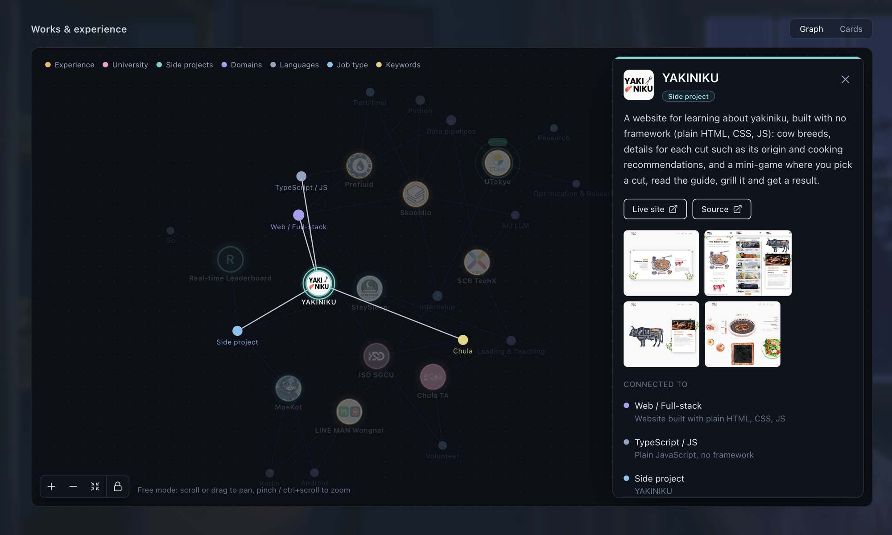
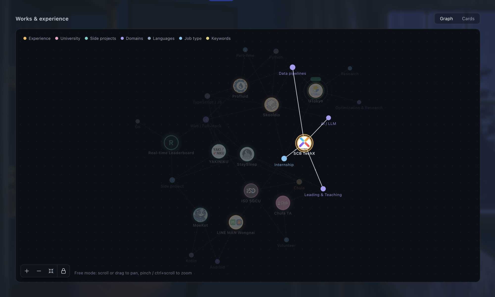

# ProjectPrism

An interactive knowledge graph of your projects and skills, made for developer
portfolios. Jobs, projects and skills are nodes; every connection carries the
sentence that justifies it; works that share a lot settle next to each other.

**Live demo:** https://taihenc.github.io/ProjectPrism/ · **In use:** https://taihenc.github.io/#works





## Features

- Click a work for a detail card: roles, highlights, links and photos. The
  camera centres the node in the space the card leaves free, and reframes the
  whole graph when the card closes.
- Hover or select to light up a node's connections; everything else dims with
  an eased fade.
- Click a legend entry to highlight a whole group (e.g. all experience).
- Flags per work: internship, part-time, full-time, volunteer, side project,
  remote, plus `status: 'current'` (pulsing ring and a NOW tag) and
  `status: 'paused'` (an "On hold" chip).
- Gentle ambient motion (drift, breathing glow, link particles), all off when
  the visitor prefers reduced motion.
- Built for touch: one finger scrolls the page, two fingers move the graph,
  and a free-move toggle unlocks panning and zooming.

> Early days: ProjectPrism is not on npm yet. For now, copy `src/prism` into
> your project or fork this repo and replace the demo data. A proper package is
> planned.

## Run the demo

```sh
git clone https://github.com/Taihenc/ProjectPrism.git
cd ProjectPrism
npm install
npm run dev
```

## Use it in your own site

Requirements: React 18 and Tailwind CSS (the component is styled with Tailwind
classes). Install the runtime dependencies:

```sh
npm install react-force-graph-2d d3-force framer-motion @heroicons/react
```

Copy `src/prism/` into your project, and make sure Tailwind scans it (add the
folder to `content` in `tailwind.config.js`).

### 1. Describe your graph

```ts
import { withKeywords } from './prism'
import type { KnowledgeGraph } from './prism'

export const myGraph: KnowledgeGraph = withKeywords(
  {
    groups: [
      { id: 'experience', label: 'Experience', color: '#f4b860' },
      { id: 'language', label: 'Languages', color: '#8fa3bf' },
      { id: 'keyword', label: 'Keywords', color: '#e6d37a' },
    ],
    nodes: [
      {
        id: 'acme',
        kind: 'work',
        group: 'experience',
        label: 'Acme',
        title: 'Acme Corp',
        roles: [{ title: 'Engineer', period: '2024 - now', engagement: 'full-time' }],
        summary: 'What you did, in one or two sentences.',
        highlights: ['One result per line.'],
        logo: '/logos/acme.png',
        images: ['/photos/acme-1.jpg'],
        keywords: ['Remote'],
      },
      { id: 'go', kind: 'topic', group: 'language', label: 'Go' },
    ],
    edges: [
      { source: 'acme', target: 'go', evidence: 'Services in Go', basis: 'stated' },
    ],
  },
  'keyword'
)
```

See [`src/demo/data.ts`](src/demo/data.ts) for a full example.

### 2. Render it

```tsx
import { PrismGraph } from './prism'
import { myGraph } from './my-graph'

export default function Projects() {
  return (
    <div style={{ height: '80vh' }}>
      <PrismGraph graph={myGraph} />
    </div>
  )
}
```

The graph fills its parent, so the parent needs a height.

## Concepts

| Term | Meaning |
| --- | --- |
| `work` node | Something you did: a job, project or activity. Click it for a detail card with roles, highlights, images and links. |
| `topic` node | A skill, language or domain. Works sharing a topic are linked through it. |
| edge | A relation plus its `evidence`. `stated` edges are solid, `inferred` ones dashed. |
| `keywords` | Tags on a work. `withKeywords` turns each one into a small shared node, so you can group works without writing nodes by hand. |
| groups | Colours and legend entries for nodes. Clicking a legend entry highlights that group. |
| `engagement` | `internship`, `part-time`, `full-time`, `volunteer` or `side-project`; set per role or on the work. Shown as chips. |
| `status` | `current` for the position you hold now, `paused` for unfinished work on hold. |

Layout: works that share neighbours are pulled together (weighted Jaccard over
shared neighbours, where rare neighbours count more), and unrelated works push
apart, so related work forms visible clusters.

## Project layout

```
src/prism/   the graph component and helpers (the future library)
src/demo/    demo page and made-up data
```

## License

MIT
